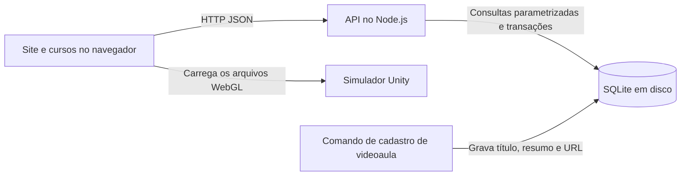

# Arquitetura e operação do banco Team Bots

O Team Bots usa SQLite para persistir o catálogo de cursos, as contas e o progresso de cada estudante. Um servidor Node.js entrega o site, o simulador Unity WebGL e a API JSON. A mesma origem atende o navegador e a API, e apenas o processo Node acessa o arquivo do banco. Este guia cobre a operação da versão atual e as decisões que antecedem a publicação para uso real.

## Arquitetura

O Node usa o driver embutido `node:sqlite`. Ao iniciar, ativa chaves estrangeiras e o modo WAL, em que alterações são registradas primeiro no arquivo de log do banco. O WAL permite que leitores avancem enquanto uma escrita ocorre. Ainda há um escritor por vez. O projeto configura uma espera de cinco segundos em caso de contenção e usa transações curtas para operações que precisam ser atômicas.

O arquivo `backend/schema.sql` define tabelas, índices e visões. O inicializador aplica esse esquema e carrega o catálogo inicial. A tabela `schema_version` identifica a versão atual. Alterações estruturais em instalações existentes ainda precisam de migrações explícitas. Executar novamente `CREATE TABLE IF NOT EXISTS` preserva a tabela existente, inclusive sua estrutura anterior.

## Modelo de dados

| Área | Tabelas principais | Regra |
| --- | --- | --- |
| Extensão | `escolas`, `turmas`, `usuarios` | Uma escola reúne turmas. O vínculo de um usuário a uma turma é opcional. |
| Sessões | `usuarios`, `sessoes` | A senha usa scrypt com sal. A API devolve um token aleatório e guarda apenas o hash dele. A sessão expira em sete dias e o logout a invalida. |
| Catálogo | `disciplinas`, `cursos`, `aulas` | Cada curso pertence a uma disciplina. A ordem de uma aula é única dentro do curso. A API pública lista apenas cursos publicados. |
| Progresso | `matriculas`, `progresso_aulas` | Há um registro de matrícula por estudante e curso e um registro de conclusão por estudante e aula. |
| Comunidade | `conteudos`, `faq`, `forum_topicos`, `forum_comentarios` | O fórum organiza comentários por tópico. A API pública retorna os comentários visíveis. |
| Circuitos | `simulador_projetos` | Cada circuito fica associado a um usuário. Gravar novamente com o mesmo título atualiza o projeto desse usuário. |

O [dicionário de dados](BANCO-DE-DADOS.md) detalha as colunas, as restrições e as visões. O schema também prevê documentos, conversas e mensagens de um tutor com IA. Essas tabelas são uma reserva de modelo para trabalho futuro.

## Videoaulas e progresso

1. O responsável pelo conteúdo cadastra a aula em um curso existente pela CLI. O comando grava o endereço HTTPS, além da posição, do título e do resumo. A mídia continua no provedor do vídeo.
2. O site consulta `GET /api/cursos` e `GET /api/cursos/:slug`. Uma aula com tipo `video` e URL válida exibe **Assistir à videoaula**.
3. O estudante autenticado escolhe **Marcar como concluída**. A API grava matrícula e conclusão na mesma transação e devolve o progresso atualizado. Repetir a ação mantém a mesma contagem.
4. Editar uma videoaula pela CLI na mesma posição preserva o ID e o progresso já registrado. Para substituir uma aula por outro conteúdo que exija nova conclusão, cadastre-a em uma posição nova.

A conclusão atual é declarada pelo estudante. O navegador abre a videoaula em outra guia, e a API não recebe dados de reprodução do provedor. Da mesma forma, as rotas de circuito permitem armazenar arquivos `.simu`, mas o canvas publicado ainda precisaria de uma integração JavaScript para gravar diretamente na conta.

## Operação

| Tarefa | Procedimento |
| --- | --- |
| Rodar a demonstração | Execute `node backend/server.mjs --demo` e abra `http://127.0.0.1:3000/`. A demonstração usa `backend/data/teambots-demo.sqlite` por padrão. |
| Rodar com dados próprios | Inicie sem `--demo`. Configure `BANCO` para o caminho absoluto de um arquivo em volume persistente. `PORTA` e `HOST` controlam a interface de escuta. |
| Testar disponibilidade | Consulte `GET /api/saude` para verificar a resposta da API e a versão do schema. |
| Cadastrar uma aula | Execute `node backend/scripts/cadastrar-videoaula.mjs [--demo] CURSO ORDEM TÍTULO URL_HTTPS [RESUMO]`. Use o mesmo modo e caminho de banco do servidor. |
| Validar mudanças | Execute `node --test backend/tests/api.test.mjs`. A suíte usa banco em memória e cobre autenticação, permissão, progresso, videoaulas e entrega dos arquivos Unity. |
| Fazer e testar backup | Use o comando `.backup` do cliente SQLite para criar uma cópia consistente com o serviço em execução. Faça a restauração primeiro em um caminho separado e confira a integridade com `PRAGMA integrity_check` antes de apontar a aplicação para ele. |

Para hospedar o sistema atual, execute a aplicação Node atrás de HTTPS com armazenamento persistente. A pasta de dados deve ficar fora da publicação estática e do Git. Durante uma restauração, pare a aplicação e aponte `BANCO` para o arquivo restaurado em um caminho novo. Assim a base anterior pode ser preservada para comparação e retorno.

## Melhorias futuras

| Prioridade | Melhoria | Resultado esperado |
| --- | --- | --- |
| Antes do piloto | Definir os vídeos autorizados, a hospedagem e a rotina de backup. Ensaiar uma restauração e o fluxo completo de cadastro, aula e progresso no ambiente escolhido. | Confirmar que o conteúdo chega ao estudante e que a equipe consegue recuperar o serviço e os dados. |
| Antes de receber estudantes | Definir quais dados coletar, quem pode acessá-los e por quanto tempo. Adotar limite de tentativas de login, revisão de sessão e um processo de recuperação de conta. | Reduzir exposição dos dados e dar à equipe meios de operar contas reais. |
| Próxima evolução do catálogo | Criar uma área de edição reservada à equipe, com revisão e visibilidade por aula. Integrar eventos do player se o grupo decidir medir reprodução. | Tirar a edição cotidiana do terminal e distinguir visualização de conclusão declarada. |
| Evolução operacional | Versionar migrações, automatizar testes em CI e medir latência, erros da API e contenção de escrita. | Detectar regressões e mudanças de carga antes de afetar usuários. |
| Se o serviço exigir mais instâncias | Avaliar um banco gerenciado com base em métricas de concorrência e na hospedagem escolhida. Ensaiar a migração com uma cópia, comparar contagens e validar a API. | Compartilhar a persistência entre instâncias quando o volume justificar. |
| Integração com o simulador | Definir com a equipe Unity como exportar e importar o conteúdo `.simu` pelo navegador. Validar versões e manter a gravação vinculada à conta. | Permitir que o aluno abra e salve circuitos sem sair do simulador. |

Referências no projeto: [instruções de execução](../README.md), [contrato HTTP](API.md), [schema](../backend/schema.sql) e [conexão SQLite](../backend/db.mjs).
