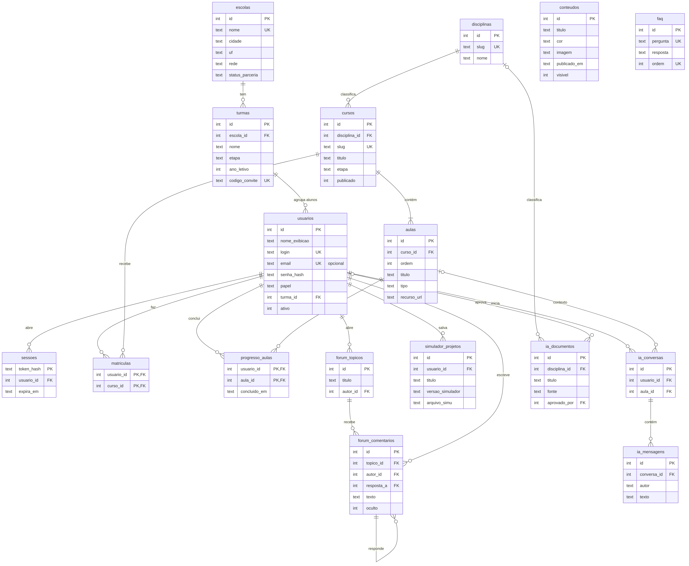

# Banco de dados do Team Bots

Modelo v1 · 10/11/2026 · responsáveis pela frente de banco: Eduardo Vinícius e Rafael Hamu

## 1. De onde veio cada tabela

Nada foi inventado do zero. Cada grupo de tabelas responde a algo que já está
no site, foi pedido no grupo ou consta na proposta da extensão.

| Origem | O que foi dito / o que existe | Tabelas |
|---|---|---|
| Site atual (`index.html`) | Cartões "Conteúdos em destaque" escritos à mão | `conteudos` |
| Site atual | FAQ com 6 perguntas fixas | `faq` |
| Site atual | "Forum de Discussões" com tópicos, comentários e respostas | `forum_topicos`, `forum_comentarios` |
| Site atual | Botão "Entrar na Comunidade" que só mostrava um aviso | `usuarios`, `sessoes` |
| Site atual | Menu "Cursos" apontando para uma seção que não existia | `disciplinas`, `cursos`, `aulas`, `matriculas`, `progresso_aulas` |
| Grupo web, 08/10 (Samuel) | "vai ter que ter um meio de cadastrar pessoas, alimentação do banco da IA interna" | `usuarios`, `ia_documentos`, `ia_conversas`, `ia_mensagens` |
| Grupo web, 04/11 (Samuel) | "Não temos ainda um banco de dados pra aplicar cursos" | `cursos`, `aulas` |
| Guia do simulador v0.5 (G3) | Botões Salvar/Abrir trabalham com arquivo `.simu` | `simulador_projetos` |
| Proposta de parceria (G1) e Márcio, 28/10 | "lista com instituições que aceitaram participar" | `escolas`, `turmas` |
| DreamShaper | A extensão precisa de evidências da ação com a comunidade | visão `vw_indicadores_escola` |

## 2. Diagrama



Fonte editável: [`modelo-er.mmd`](modelo-er.mmd) (Mermaid). Versão vetorial: [`modelo-er.svg`](modelo-er.svg).

São 18 tabelas, 8 índices e 3 visões. O arquivo que manda é o
[`backend/schema.sql`](../backend/schema.sql); este documento explica.

## 3. Dicionário de dados

Convenções: `id` é sempre chave primária inteira; datas são texto ISO-8601 em
UTC; campos "0/1" são booleanos.

### 3.1 Extensão

**`escolas`** — instituições da prospecção.

| Coluna | Tipo | Regra | Significado |
|---|---|---|---|
| nome | texto | único | Nome da escola |
| cidade, uf | texto | uf com 2 letras | Localização |
| rede | texto | `municipal`, `estadual`, `federal`, `privada` | Rede de ensino |
| status_parceria | texto | `prospeccao`, `em_conversa`, `aceita`, `recusada` | Andamento do contato |
| contato_nome | texto | opcional | Pessoa da direção/coordenação |
| observacoes | texto | opcional | Anotações da prospecção |

**`turmas`** — turmas atendidas em cada escola.

| Coluna | Tipo | Regra | Significado |
|---|---|---|---|
| escola_id | inteiro | FK → escolas | Escola da turma |
| nome | texto | único por escola e ano | Ex.: "9º ano A" |
| etapa | texto | `fundamental_2`, `medio` | Etapa de ensino |
| ano_letivo | inteiro | | Ex.: 2026 |
| codigo_convite | texto | único | Código que o aluno digita no cadastro |

### 3.2 Pessoas e acesso

**`usuarios`**

| Coluna | Tipo | Regra | Significado |
|---|---|---|---|
| nome_exibicao | texto | | Como aparece no site |
| login | texto | único, sem diferenciar maiúsculas | Apelido ou e-mail |
| email | texto | opcional, único | Só preenchido se o login for e-mail |
| senha_hash | texto | | `sal:hash` gerado com scrypt. A senha nunca é gravada |
| papel | texto | `aluno`, `professor`, `equipe`, `admin` | Define o que pode acessar |
| turma_id | inteiro | FK → turmas, opcional | Turma do aluno |
| ativo | 0/1 | | Conta desativada não entra |

**`sessoes`** — quem está logado.

| Coluna | Tipo | Regra | Significado |
|---|---|---|---|
| token_hash | texto | PK | SHA-256 do token. O token puro só existe no navegador |
| usuario_id | inteiro | FK → usuarios, apaga em cascata | Dono da sessão |
| expira_em | texto | | Validade (7 dias) |

### 3.3 Cursos

**`disciplinas`** — `slug` e `nome` (Matemática, Física, Química, Eletrônica).

**`cursos`**

| Coluna | Tipo | Regra | Significado |
|---|---|---|---|
| disciplina_id | inteiro | FK → disciplinas | Área do curso |
| slug | texto | único | Identificador na URL (`primeiros-circuitos`) |
| titulo, descricao | texto | | Texto do cartão |
| etapa | texto | `fundamental_2`, `medio`, `ambos` | Público |
| publicado | 0/1 | | Só aparece no site se for 1 |

**`aulas`**

| Coluna | Tipo | Regra | Significado |
|---|---|---|---|
| curso_id | inteiro | FK → cursos, apaga em cascata | Curso da aula |
| ordem | inteiro | > 0, única dentro do curso | Posição |
| titulo, resumo | texto | | Texto da aula |
| tipo | texto | `texto`, `video`, `exercicio`, `simulador` | Formato |
| recurso_url | texto | opcional | Vídeo, PDF ou página do simulador |

**`matriculas`** — par (`usuario_id`, `curso_id`). Criada sozinha quando o aluno conclui a primeira aula.

**`progresso_aulas`** — par (`usuario_id`, `aula_id`) + `concluido_em`. A chave composta impede contar a mesma aula duas vezes.

### 3.4 Página inicial

**`conteudos`**

| Coluna | Tipo | Regra | Significado |
|---|---|---|---|
| titulo, resumo | texto | | Texto do cartão |
| cor | texto | `blue`, `red` | Vira a classe `blue-card` / `red-card` do `style.css` |
| imagem | texto | `tech`, `code`, `robot`, `team` | Vira a classe `*-image` |
| texto_link, url | texto | | Link do cartão |
| publicado_em | texto | | Data mostrada |
| visivel | 0/1 | | Esconde sem apagar |

**`faq`** — `pergunta` (única), `resposta`, `ordem` (única).

### 3.5 Fórum

**`forum_topicos`** — `titulo`, `autor_id` (FK → usuarios), `criado_em`.

**`forum_comentarios`**

| Coluna | Tipo | Regra | Significado |
|---|---|---|---|
| topico_id | inteiro | FK → forum_topicos, cascata | Tópico |
| autor_id | inteiro | FK → usuarios, cascata | Quem escreveu |
| resposta_a | inteiro | FK → forum_comentarios, opcional | Vazio = comentário raiz |
| texto | texto | 1 a 1000 caracteres | Mensagem |
| oculto | 0/1 | | Moderação: some do site sem apagar o registro |

### 3.6 Simulador

**`simulador_projetos`**

| Coluna | Tipo | Regra | Significado |
|---|---|---|---|
| usuario_id | inteiro | FK → usuarios, cascata | Dono |
| titulo | texto | único por usuário | Nome do circuito |
| versao_simulador | texto | | Versão da build que gerou (ex.: `0.5`) |
| arquivo_simu | texto | até 1 MB | Conteúdo do arquivo `.simu` |

### 3.7 Tutor com IA

Estrutura criada, **sem rotas na API ainda**: o grupo não definiu qual IA será
usada nem como ela se comunica.

- **`ia_documentos`** — base de conhecimento: `titulo`, `fonte`, `texto`, `disciplina_id`, `aprovado_por`. Um documento só deve alimentar a IA depois de revisado por alguém da equipe.
- **`ia_conversas`** — uma conversa por aluno, com `aula_id` opcional (contexto da dúvida).
- **`ia_mensagens`** — `autor` (`aluno` ou `tutor`), `texto`, `criado_em`.

### 3.8 Visões

| Visão | Entrega |
|---|---|
| `vw_forum_topicos` | Tópico + autor + contagem de comentários visíveis |
| `vw_progresso_curso` | Por aluno e curso: aulas totais e concluídas |
| `vw_indicadores_escola` | Por escola: turmas, alunos cadastrados, aulas concluídas, circuitos salvos |

## 4. Decisões e porquês

**SQLite agora.** O grupo ainda não escolheu hospedagem (a Thaís está
pesquisando servidores gratuitos) nem a linguagem do back-end. O SQLite vem
embutido no Node, não exige instalar servidor de banco e roda em qualquer
notebook. O banco inteiro é um arquivo.

**Trocar de banco depois é barato.** O SQL usa só recursos comuns. Para MariaDB
(usado no MVP do Samuel) ou PostgreSQL, as mudanças são mecânicas:

| No SQLite | No MariaDB | No PostgreSQL |
|---|---|---|
| `INTEGER PRIMARY KEY` | `INT AUTO_INCREMENT PRIMARY KEY` | `INTEGER GENERATED ALWAYS AS IDENTITY PRIMARY KEY` |
| `TEXT` em colunas com `UNIQUE` | `VARCHAR(n)` | `TEXT` |
| datas em `TEXT` ISO | `DATETIME(3)` | `TIMESTAMPTZ` |
| `INSERT OR IGNORE` | `INSERT IGNORE` | `ON CONFLICT DO NOTHING` |
| `COLLATE NOCASE` | collation `_ci` (padrão) | `CITEXT` ou índice em `lower(login)` |
| `PRAGMA foreign_keys = ON` | já é padrão no InnoDB | já é padrão |

Esse roteiro ainda não foi executado em um servidor MariaDB ou PostgreSQL.
A troca fica concentrada em `schema.sql` e `db.mjs`; as rotas não mudam.

**Dados de menores.** O público é de ensino fundamental e médio. Por isso o
cadastro pede o mínimo: nome de exibição, login e senha. Sem CPF, endereço,
telefone ou data de nascimento. E-mail é opcional. Antes de usar com alunos de
verdade, a escola e os professores precisam definir como será o consentimento
dos responsáveis — isso é decisão da coordenação, não do banco.

**Senha e sessão.** Senha passa por scrypt com sal aleatório por usuário. O
token de sessão é guardado só como SHA-256: quem copiar o arquivo do banco não
consegue entrar na conta de ninguém com o que está lá.

**Integridade no banco, não só no código.** `CHECK`, `UNIQUE` e chaves
estrangeiras recusam dado errado mesmo que alguém grave direto no arquivo.
Apagar um usuário leva junto sessões, matrículas, progresso, circuitos,
comentários e conversas (`ON DELETE CASCADE`), o que atende pedido de exclusão
de conta. A exceção é quem abriu tópico no fórum: o banco recusa apagar até o
tópico ser passado para outra conta, para não sumir com a discussão dos outros.

**Moderação sem apagar.** Comentário impróprio recebe `oculto = 1`: some do
site e da contagem, mas fica o registro.

**Versão do schema.** A tabela `schema_version` registra a versão aplicada.
Mudanças futuras entram como versão 2, 3… em vez de editar o que já foi criado.

## 5. Dados iniciais

O servidor carrega estes dados quando o banco está vazio (`carregarDadosIniciais` em `db.mjs`):

- 4 cartões, 6 perguntas do FAQ, 3 tópicos e 2 comentários — **cópia fiel do que estava no `index.html`**.
- 4 disciplinas.
- 1 curso de exemplo, "Primeiros circuitos", com 5 aulas tiradas do escopo do simulador do G3 (circuito aberto/fechado, pilhas em série, polaridade do LED, resistor e Lei de Ohm, bateria de batata). Os textos das aulas são rascunho para o grupo revisar.
- Em modo `--demo`, 1 escola, 1 turma e 4 contas **fictícias** em um arquivo SQLite separado. O início padrão carrega o catálogo sem essas contas ou turmas.

## 6. Consultas úteis

Abrir o banco: `sqlite3 backend/data/teambots.sqlite` ou a extensão "SQLite Viewer" do VS Code.

```sql
-- Alcance por escola (evidência para a DreamShaper)
SELECT * FROM vw_indicadores_escola;

-- Quem concluiu o quê
SELECT u.nome_exibicao, p.titulo, p.aulas_concluidas, p.aulas_total
  FROM vw_progresso_curso p JOIN usuarios u ON u.id = p.usuario_id;

-- Cadastrar uma escola real e uma turma
INSERT INTO escolas (nome, cidade, uf, rede, status_parceria, criado_em)
VALUES ('Nome da escola', 'Uberaba', 'MG', 'estadual', 'em_conversa', strftime('%Y-%m-%dT%H:%M:%fZ','now'));
INSERT INTO turmas (escola_id, nome, etapa, ano_letivo, codigo_convite, criado_em)
VALUES (2, '8º ano B', 'fundamental_2', 2026, 'ESCOLA-8B', strftime('%Y-%m-%dT%H:%M:%fZ','now'));

-- Publicar um novo cartão na página inicial
INSERT INTO conteudos (titulo, resumo, cor, imagem, publicado_em)
VALUES ('Simulador no ar', 'Monte seu primeiro circuito no navegador.', 'blue', 'tech', '2026-11-10');

-- Ocultar um comentário
UPDATE forum_comentarios SET oculto = 1 WHERE id = 3;
```

## 7. O que falta decidir (não é do banco)

1. **Hospedagem e banco definitivo** — depende da pesquisa de servidores.
2. **IA** — qual serviço, quem responde por ele e que dados usa. As tabelas existem; as rotas dependem dessa definição.
3. **Salvar circuito direto na conta** — depende de o simulador (G3) expor o conteúdo do `.simu` por JavaScript.
4. **Telas de administração** — hoje escolas, turmas, cursos e cartões entram por SQL. Uma tela para a equipe é o próximo passo natural.
5. **Consentimento dos responsáveis** — definir com os professores antes de cadastrar alunos reais.
